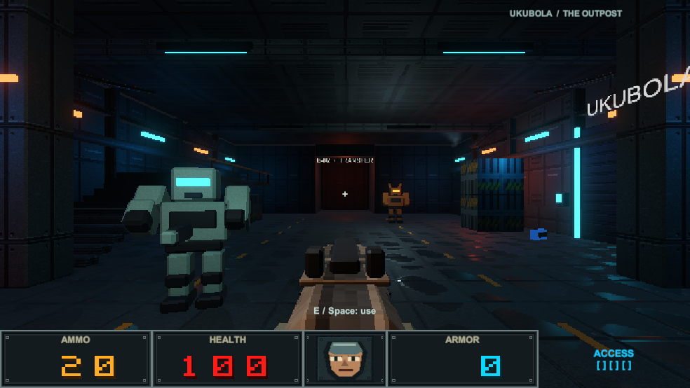
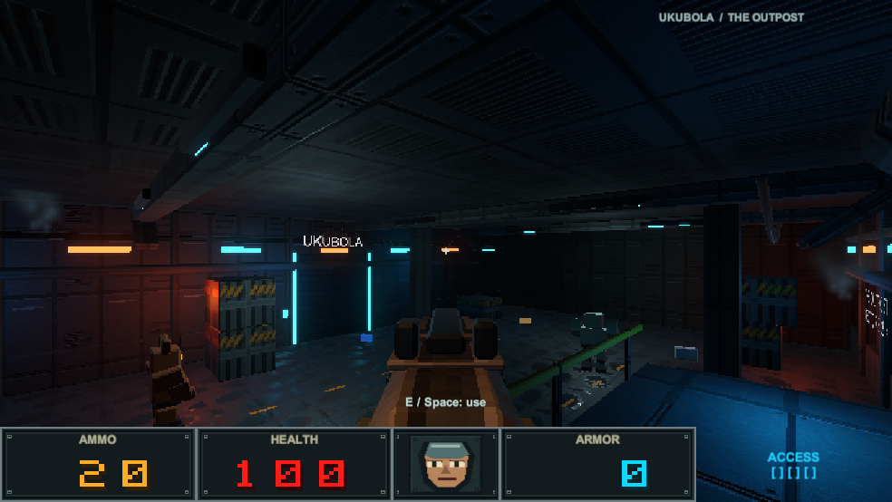

# Evidencia del laboratorio P18

Ver [Windows validado](Windows/README.md): matriz completa Bajo/Medio/Alto/4:3, 24 capturas y comprobaciones de shaders, escalera y navegación. [Windows parcial](WindowsParcial/README.md) conserva el intento anterior y su limitación de Alto.

Las seis imágenes de `Editor/` proceden de cámaras reales de ArtRoom, con HUD separado, 640x360 internos y una salida del Game View de 984x554. Actores congelados para comparar posiciones. No son renders conceptuales ni prueban que una distribución Windows esté aprobada.

`run-result.json` registra dimensiones, dispositivo y comprobaciones físicas de escalera y navegación. El XML de NUnit conserva las 16 pruebas aprobadas. `art-generator-test.json` registra reproducción idéntica y protección frente a una edición manual, usando una copia aislada del generador.

Ver VALIDACION_Y_CONTINUIDAD para los builds rechazados por materiales ausentes y el intento Windows activo. Ninguna métrica estática de estos archivos certifica los objetivos de P26. P19 y la campaña nueva todavía no están implementados.
