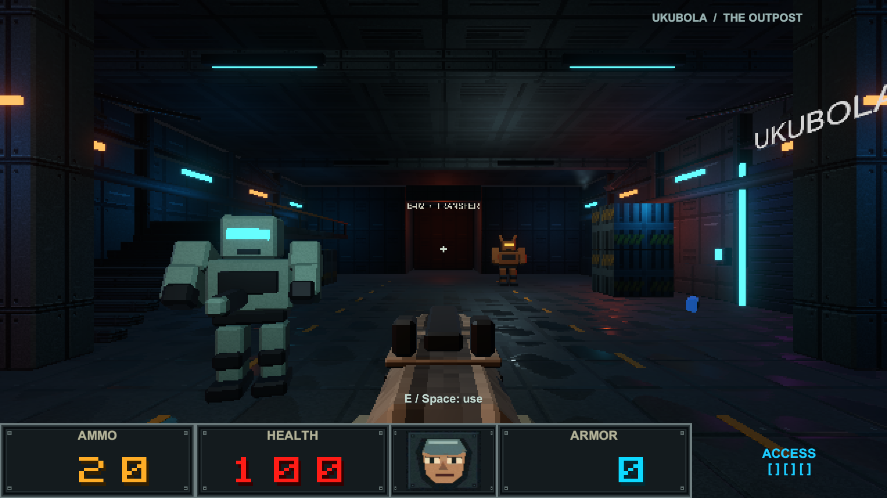
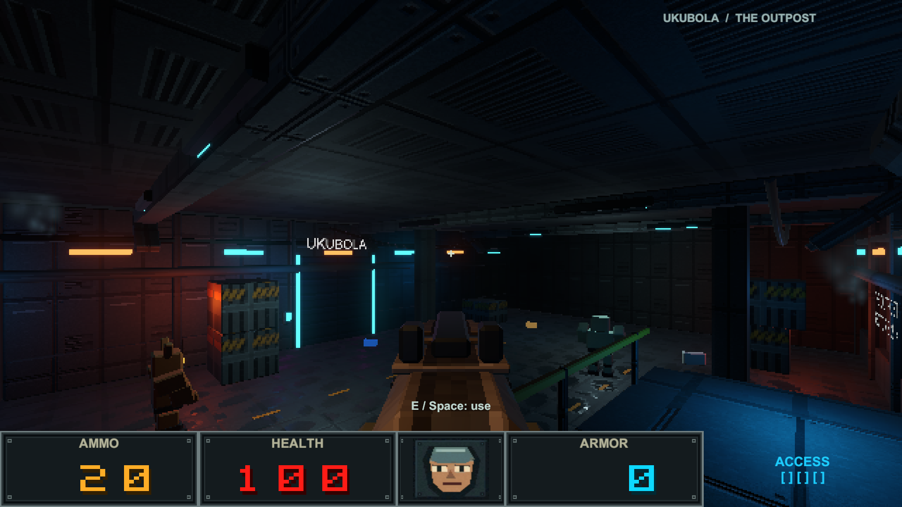

# Base gráfica P18 validada en Windows

Build `68cc764922b44986849332fdd893b0eb`, Unity 6000.6.10f1, D3D11, GTX 1650.
La matriz `presentation-069f565c3b4a4b48a21beb4a44a007d4` pasó cuatro casos:

| Perfil | Salida renderizada | Mundo interno | Resultado |
|---|---|---|---|
| Bajo | 1280x720 | 480x270 | Correcto |
| Medio | 1920x1080 | 640x360 | Correcto |
| Alto | 2560x1440 | 960x540 | Correcto |
| Medio 4:3 | 1280x960 | 480x360 | Correcto |

Cada caso produjo seis capturas válidas y pasó la subida física de 2.4 m sin
salto, la conexión NavMesh y el log sin variantes ausentes ni errores de shader.
Se inspeccionaron vistas frontal, lateral y desde la pasarela. Las seis imágenes
`capture-*` son del perfil Medio; se adjuntan además vistas de Alto y 4:3.

Alto renderiza mundo y UI a textura 2560x1440; la ventana física quedó en
1920x1080 por el monitor. Los informes distinguen ambas dimensiones. Esto valida
el layout renderizado, no una prueba en otro monitor de 1440p.

`build-files.json` registra 326 archivos, 213115860 bytes, hashes y fuentes.
`result.json` contiene la matriz completa. Las muestras de tiempo son estáticas
y con Editor abierto: no certifican P26. El pulido de HUD, animaciones, combate,
audio y la evaluación >=4/5 de la sección integrada corresponden a P19/P24.

La base P18 queda técnicamente aceptada. Esto no representa una campaña nueva
completada ni igualdad visual con la referencia opción C.
