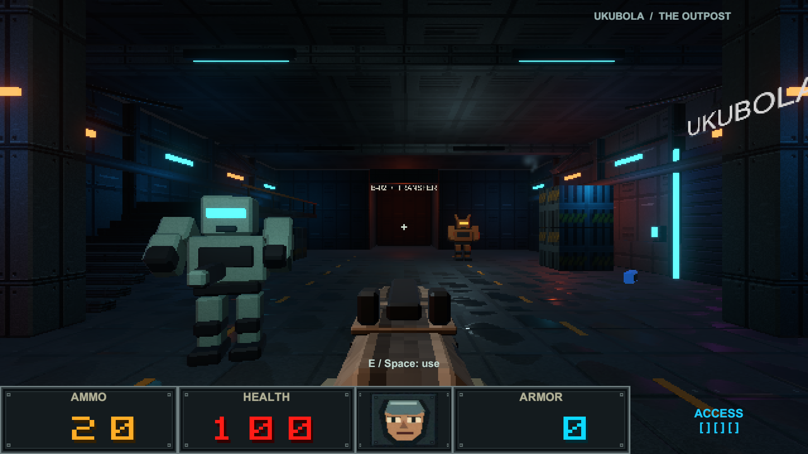
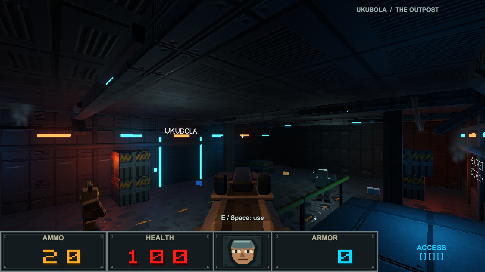

# Evidencia Windows parcial

Build `75b35a8ce3d645af863f027901f431e0`, Unity 6000.6.10f1, GTX 1650.
Las seis imágenes son capturas reales del ejecutable en Medio: salida 1920x1080,
mundo 640x360 y HUD independiente. Actores congelados para comparar posiciones.

Bajo, Medio y Medio 4:3 pasaron dimensiones, escalera, navegación, validación de
imágenes y revisión del log sin variantes de shader ausentes. Sus informes están
adjuntos. `build-files.json` registra 326 archivos con hashes, además de los
fuentes presentes durante esta validación. El XML conserva 16 pruebas EditMode.

**Esto no acepta P18 completa:** Alto de este build fue rechazado por variantes
receptoras ausentes. La corrección está compilándose en otro build; consultar
VALIDACION_Y_CONTINUIDAD antes de reanudar. Las muestras de tiempo son estáticas,
con Editor abierto, y no acreditan los objetivos de P26. Tampoco son evidencia
de una sección P19 terminada o de la campaña reconstruida.
