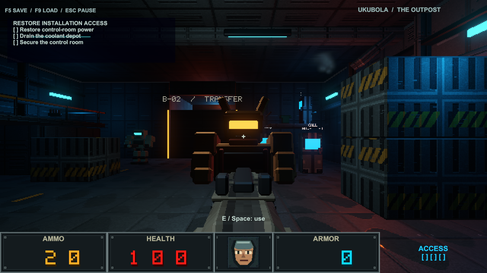

# UKUBOLA

FPS retro para Windows x64, desarrollado con Unity **6000.6.10f1** y URP **17.6**.

La entrega del 26 de noviembre de 2026 reúne una nueva sección industrial de **The Outpost** y la campaña original conservada. Es una **preview de evolución**; la reconstrucción completa de las tres misiones del plan maestro continúa pendiente.



## Qué incluye

- **Outpost Preview:** personajes y armas 3D, materiales industriales, iluminación horneada, vapor, HUD independiente y renderizado de píxeles cuadrados a 640×360 en perfil Medio.
- Combate con pistola y escopeta, siete enemigos Guard/Imp, tarjeta azul, puertas normales/remotas, elevador de carga, escalera, refrigerante drenable, barriles, secreto, emboscada y salida por objetivos.
- Guardado v2 de mecanismos en movimiento, estado de enemigos, recursos y objetivos. F5 guarda y F9 carga.
- Entrada en pausa hasta comenzar y opciones básicas de calidad, aspecto, FOV y sensibilidad, persistidas separadamente del progreso.
- **Campaña original:** menú y tres misiones conservados, con sus ocho armas y cuatro arquetipos existentes. Su guardado v1 permanece separado del de la preview.
- Fuentes, generadores y pruebas reproducibles. No hacen falta Blender ni recursos descargados para regenerar el arte nuevo.

## Jugar

La distribución Windows se entregará como ZIP en GitHub Releases cuando termine su verificación. Extraer completamente antes de ejecutar. La preview y la campaña original deben conservar sus carpetas de datos independientes.

| Control | Acción |
|---|---|
| Clic inicial | Capturar el ratón |
| WASD | Moverse |
| Ratón | Girar horizontalmente |
| Shift | Correr |
| Botón izquierdo | Disparar |
| E / Espacio | Usar puerta, consola o plataforma |
| 2 / 3 | Pistola / escopeta en la preview |
| F5 / F9 | Guardar / cargar en la preview |
| Esc | Pausa |
| Alt+F4 | Cerrar |

Se mantiene autoapuntado vertical; no hay salto ni agachado. La tarjeta está en el almacén. El interruptor del taller abre el paso al depósito; la bomba permite drenar el refrigerante por una ruta segura. Restaurar energía y asegurar control completa las condiciones de salida.

## Abrir el proyecto

Usar Unity **6000.6.10f1**, conservando `Packages/manifest.json` y `packages-lock.json`. Las escenas y recursos generados se incluyen en el repositorio.

- Preview: `Assets/_UKUBOLA/Scenes/Evolution/OutpostSlice.unity`.
- Campaña original: `Assets/_UKUBOLA/Scenes/Menus/SaveCampaignTitle.unity`.
- Herramientas: `Tools > UKUBOLA > Evolution` en Unity.
- Automatización externa: `Tools/Invoke-UkubolaJob.ps1`. Utiliza la instancia abierta del Editor mediante una cola serial; no abrir el mismo proyecto en dos instancias.

```powershell
./Tools/Invoke-UkubolaJob.ps1 -Operation RunEditTests
./Tools/Test-UkubolaSliceGeneration.ps1
./Tools/Invoke-UkubolaJob.ps1 -Operation BakeOutpostSlice
./Tools/Invoke-UkubolaJob.ps1 -Operation PlayQa -Scene Assets/_UKUBOLA/Scenes/Evolution/OutpostSlice.unity
./Tools/Invoke-UkubolaJob.ps1 -Operation PlaySliceRoute -Scene Assets/_UKUBOLA/Scenes/Evolution/OutpostSlice.unity
```

## Estado verificable

31 pruebas EditMode correctas; cuatro perfiles/aspectos en Windows con 24 capturas y nueve comprobaciones runtime por caso; recorrido Windows completado con equipamiento inicial, enemigos activos, daño normal, ambas armas, secreto, escalera/elevador, carga, salida y muerte/reintento. Dos generaciones consecutivas conservan identidades, colocaciones, geometría estática y cantidades. Menú inicial y opciones comprobados visualmente; la revisión manual de teclado/cursor se interrumpió al detener el usuario el control gráfico.

El recorrido automático conoce la ruta y dura aproximadamente un minuto; no demuestra la duración de una primera exploración de 5–8 minutos. Las muestras del Editor no certifican 60 FPS en el ejecutable. La evaluación visual 4/5 del plan, la revisión auditiva, reasignación/accesibilidad/automapa nuevos y la regresión completa de campaña en tres dificultades siguen pendientes.

El alcance y las evidencias se mantienen en [Docs/UKUBOLA](Docs/UKUBOLA/ESTADO_Y_CAMBIOS.md). La decisión de entrega con plazo está en [ENTREGA_PREVIEW.md](Docs/UKUBOLA/ENTREGA_PREVIEW.md).

## Procedencia

Arte industrial, meshes, tipografía 5×7 y texturas nuevas: generadores incluidos en el proyecto. Audio y retratos: recursos preexistentes de UKUBOLA. Motor y paquetes: Unity y sus respectivos proveedores; sus avisos se incluirán con la distribución. La imagen de opción C es una referencia aportada por el usuario, no una captura del juego. Esta entrega no establece una nueva licencia de código abierto para el proyecto.
